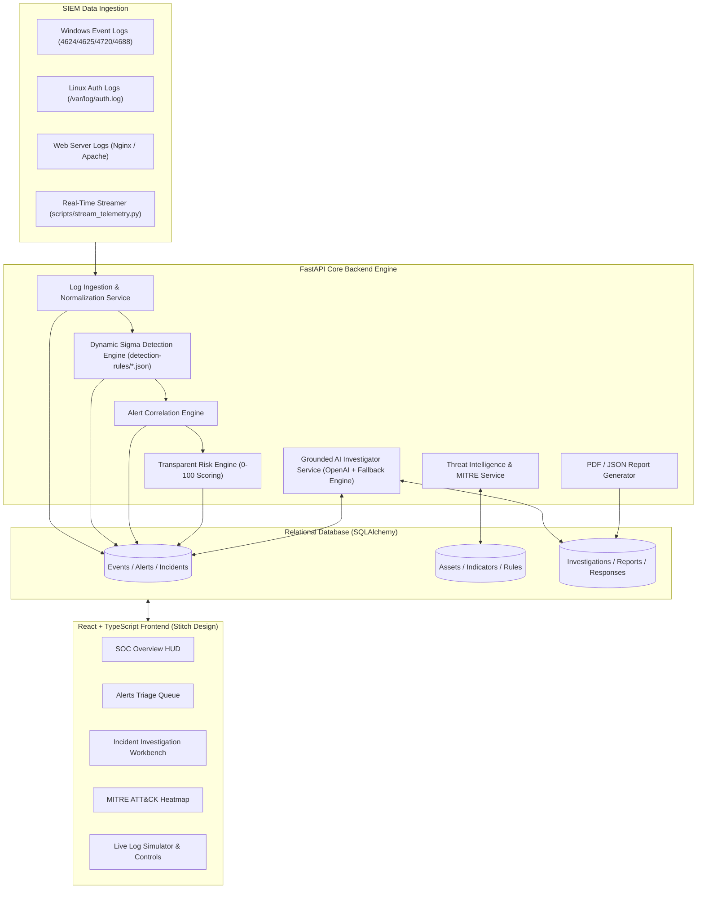
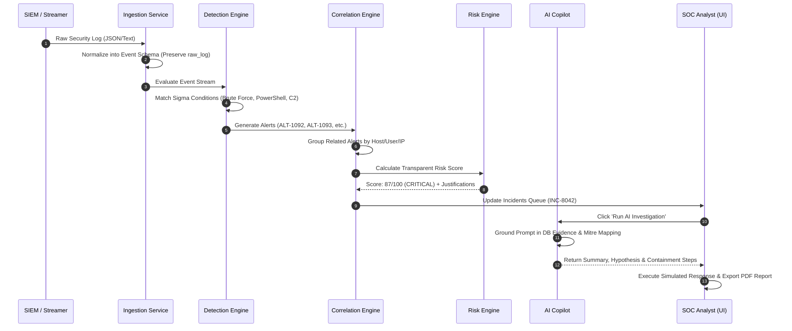
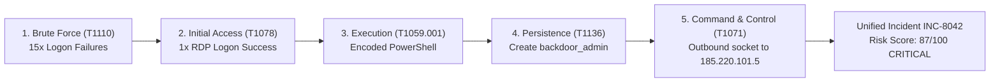

# 🛡️ AI SOC Investigation Assistant ("Obsidian Sentinel")

An enterprise-grade, real-time Security Operations Center (SOC) platform designed to help security analysts ingest SIEM logs, normalize security events, detect threats with dynamic Sigma rules, correlate related alerts into unified incidents, score risk transparently (0-100), conduct AI-assisted investigation workflows, map activity to MITRE ATT&CK, enrich threat intelligence, generate incident reports, and execute safe simulated response actions.

Built using the exact visual source of truth from Google Stitch project ID `17733660456581246202` ("Obsidian Sentinel" design system).

---

## 📌 Description

The **AI SOC Investigation Assistant** bridges the gap between raw telemetry ingestion and intelligent threat investigation. Unlike static dashboards or mockups, this platform is a **fully functional full-stack application**:
- Consumes real security events (Windows Event ID 4624/4625/4720/4688, Linux `/var/log/auth.log`, Nginx/Apache access logs).
- Executes dynamic Sigma-inspired rule detection algorithms.
- Automatically correlates multi-stage attack chains into unified incidents.
- Computes deterministic risk scores with explicit justification factors.
- Provides evidence-grounded AI copilot reasoning with strict safety guardrails.
- Allows real-time live log streaming and safe automated response simulation.

---

## 📐 Architecture Flowchart & Workflow Diagrams

### 1. System Architecture Flowchart


### 2. End-to-End Threat Correlation & Investigation Workflow


### 3. Primary Demo Attack Scenario Flowchart


---

## 🗄️ Relational Data Models

The data layer uses SQLAlchemy ORM (`backend/app/models/all_models.py`):

| Model | Key Fields | Description |
| :--- | :--- | :--- |
| **`User`** | `id`, `username`, `email`, `password_hash`, `role`, `created_at` | Authenticated SOC analyst accounts (BCrypt hashed passwords). |
| **`Event`** | `id`, `timestamp`, `source`, `event_type`, `hostname`, `username`, `source_ip`, `destination_ip`, `process`, `command_line`, `raw_log` | Normalized SIEM telemetry preserving original raw log as immutable evidence. |
| **`Alert`** | `id`, `alert_id`, `title`, `description`, `severity`, `status`, `detection_rule`, `mitre_technique`, `event_count`, `risk_score` | Rule detection triggers linked to correlated events. |
| **`Incident`** | `id`, `incident_id`, `title`, `description`, `severity`, `status`, `risk_score`, `confidence`, `assigned_to` | Aggregated threat campaign uniting correlated alerts & events. |
| **`Asset`** | `id`, `hostname`, `ip`, `operating_system`, `owner`, `criticality`, `risk_score`, `status` | Enterprise host and domain controller risk posture mapping. |
| **`Indicator`** | `id`, `value`, `type`, `reputation`, `confidence`, `threat_actor`, `first_seen`, `last_seen` | Known malicious/suspicious IPs, domains, URLs, and file hashes. |
| **`DetectionRule`** | `id`, `rule_id`, `name`, `description`, `severity`, `mitre_technique`, `enabled`, `rule_definition` | Dynamic Sigma-style JSON rule definitions. |
| **`MitreTechnique`** | `id`, `technique_id`, `name`, `tactic`, `description` | Standard MITRE ATT&CK technique mapping registry. |
| **`Investigation`** | `id`, `incident_id`, `ai_summary`, `confidence`, `findings`, `recommendations` | Grounded AI copilot findings (summary, hypothesis, false positives, response). |
| **`Report`** | `id`, `incident_id`, `title`, `executive_summary`, `details_json` | Generated PDF/JSON report metadata. |
| **`ResponseAction`** | `id`, `incident_id`, `action`, `status`, `target`, `details` | Containment action execution history marked as `SIMULATED`. |

---

## 🚀 Instructions & Process Guide

### 1. Running Locally

#### Backend Setup
```bash
# Navigate to backend
cd backend

# Install Python dependencies
pip install -r requirements.txt

# Launch FastAPI server (auto-seeds database on startup)
python -m uvicorn app.main:app --host 127.0.0.1 --port 8000
```
Backend API will be live at `http://127.0.0.1:8000` (Swagger docs at `http://127.0.0.1:8000/docs`).

#### Frontend Setup
```bash
# Navigate to frontend
cd frontend

# Install Node dependencies
npm install

# Build & launch Vite development server
npm run dev
```
Open **[http://localhost:3000](http://localhost:3000)** in your browser.

#### 🔑 Credentials
- **Username**: `analyst`
- **Password**: `password123`

---

### 2. Real-Time Telemetry Ingestion Options

#### Option A: Background Live Streamer Script
Run the real-time telemetry streamer to continuously inject live security events every 3 seconds:
```bash
python scripts/stream_telemetry.py
```

#### Option B: UI Live Simulator Page
Navigate to **[http://localhost:3000/settings](http://localhost:3000/settings)** to paste raw logs directly into the engine via UI.

---

### 3. Running via Docker Compose

```bash
docker-compose up --build
```
Access the application at `http://localhost:3000`.

---

### 4. Running Tests

Run backend pytest suite:
```bash
$env:PYTHONPATH="backend"; python -m pytest tests/test_backend.py -v
```

---

## 📄 Documentation Sitemap
- [System Architecture Specification](docs/architecture.md)
- [Detection Engine & Rules Documentation](docs/detection-engine.md)
- [AI Investigation & Guardrails Guide](docs/ai-investigation.md)
- [Security Architecture & Controls](docs/security.md)
